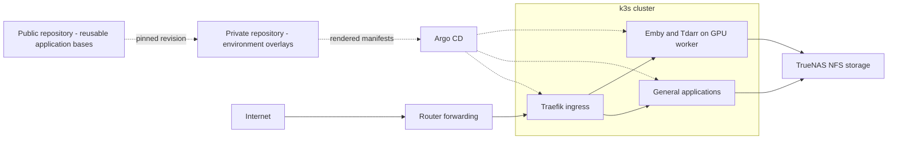

# Homelab Platform

**This is a sanitized reference implementation, not the live deployment repository.**
Domains, IP addresses, pool names and node selectors are examples. Read
[the private overlay guide](docs/private-overlays.md) before deploying anything.
The examples retain the original sync policies and schedules; customize them before registration.

A two-node k3s homelab managed through Argo CD, with persistent application
storage on TrueNAS. It runs household media, photo, file-sync and supporting
services, and is a learning project in Kubernetes, GitOps and operating stateful
applications.

To deepen my understanding of the systems I maintain and ensure quality control,
all AI-assisted code requires human review and scrutiny before deployment.
AI assistance supports implementation; responsibility for design decisions,
validation and operation remains with the maintainer.

## Current architecture

The manifests describe the architecture below. The owner reports the migrated
applications working as of November 6, 2026; recovery testing is tracked separately.

| Component | Role |
|---|---|
| Control-plane node | Physical Debian control plane and general application host; Traefik ingress |
| GPU worker node | Debian GPU worker for Emby and the Tdarr worker |
| TrueNAS | NFS application state, personal files and shared media; Scrutiny stays on the NAS |
| Argo CD | Reconciles registered Git paths; sync policy varies by Application |
| Traefik + cert-manager | Public routing and certificate management |

The diagram separates deployment control from application traffic. Dashed arrows
show configuration dependencies and deployment control; solid arrows show requests
and storage access. The public-base/private-overlay split is the intended GitOps
structure; switching the live Argo sources to these overlays is still pending.



This is not a highly available cluster. There is one control plane, ingress is
pinned to its host, and persistent workloads depend on the NAS. Two nodes do not
provide automatic control-plane or public-ingress failover.

Higher availability is a planned next phase: redundant control-plane capacity,
service failover and an ingress path that survives a node failure. The design
must also account for shared storage and prevent competing database writers;
these protections are not implemented yet.

## Repository map

| Directory | Contents |
|---|---|
| [bootstrap/](bootstrap/README.md) | Host and application setup toolkit and initial Argo Application registrations |
| [argocd/edge-applications/](argocd/edge-applications/) | Argo Application registrations for shared infrastructure and OpenSpeedTest |
| [cluster/apps/](cluster/apps/) | Application workloads, Services, storage and app-specific public routes |
| [cluster/infrastructure/](cluster/infrastructure/) | Shared Traefik settings, certificate infrastructure, redirects, Argo settings and backup/notification CronJobs |
| [cluster/namespaces/](cluster/namespaces/namespaces-README.md) | Application namespace definitions |
| [docs/operations/](docs/operations/) | Operational and recovery guidance |
| [docs/incidents/](docs/incidents/) | Dated incident evidence |
| [docs/case-studies/](docs/case-studies/truenas-to-k3s.md) | Migration history and lessons |

Registration YAMLs intentionally remain in `bootstrap/`: they point Argo at
workload directories rather than duplicating those workloads. The `edge-applications`
parent manages the registrations in `argocd/edge-applications/`. It is still used;
it is not a separate proxy for each app. Each application owns its own public
routes. Shared Traefik, certificate and redirect configuration stays in infrastructure.
Not every live Application has a checked-in registration yet.

## Applications

| App directory | Namespace | Purpose |
|---|---|---|
| [arr-stack](cluster/apps/arr-stack/README.md) | `media` | Prowlarr indexers, Sonarr/Radarr libraries and Unpackerr extraction |
| [qbittorrent](cluster/apps/qbittorrent/) | `media` | VPN-backed torrent downloads and seeding; tracker-approved version pinned |
| [nzbget](cluster/apps/nzbget/README.md) | `media` | Usenet downloads |
| [emby](docs/operations/emby.md) | `media` | Media streaming with GPU hardware transcoding |
| [tdarr](cluster/apps/tdarr/) | `media` | Scheduled media processing with a server and GPU worker |
| [immich](cluster/apps/immich/) | `data` | Photo library and uploads |
| [nextcloud](cluster/apps/nextcloud/) | `data` | File storage and sync |
| [seerr](cluster/apps/seerr/README.md) | `tools` | Media requests connected to Sonarr and Radarr |
| [tracearr](cluster/apps/tracearr/) | `tools` | Playback monitoring |
| [cloudflare-ddns](cluster/apps/cloudflare-ddns/README.md) | `tools` | Public IPv4 DNS updates |
| [openspeedtest](cluster/apps/openspeedtest/README.md) | `tools` | Browser-based speed testing |

Scrutiny remains on the NAS for drive access. The decision about migrating
Tailscale is deferred.
Kubernetes system components also use `kube-system`, `argocd` and `cert-manager`.

## Storage and recovery

Application storage uses static NFS-backed PV/PVC definitions. The bundled k3s
local-path provisioner is separate; there is no dynamic NFS provisioner here.
A PV binds to one PVC; pods in the same namespace can share a ReadWriteMany (RWX) claim.
Different namespace claims require separate PV objects even when they reference
the same export. Declared PV capacities do not enforce NAS dataset quotas.

| NAS location | Use |
|---|---|
| `/mnt/application-pool/k3s-app-data/` | Most application configs and databases; separate directories per app |
| `/mnt/application-pool/configs/immich/storage` | Immich uploaded/derived assets; database has a separate `immich-db` directory |
| `/mnt/application-pool/configs/tdarr/temp` | Shared Tdarr processing cache |
| `/mnt/storage-pool/media-data` | Downloads and libraries, generally mounted as `/media-data` |
| `/mnt/storage-pool/nextcloud-data/user-data` | Nextcloud user files |

Immich assets still use the older `configs/immich/storage` location. Moving them
to a dedicated storage location is planned; no path has changed yet. Tdarr's
`temp` directory is its shared transcode workspace, mounted as `/temp` in both
server and worker. Moving that workspace out of the legacy configs directory is
also planned, preserving matching paths across the server and workers. Emby's
transcode workspace is planned to move to a dedicated scratch disk. These are
future storage changes; the existing mounts remain in use.

Central storage made it possible to replace compute hosts without copying all
media. It also makes NAS availability and NFS permission/locking behavior part
of application reliability. SQLite-on-NFS is an accepted lab trade-off, not a
recommendation for all deployments. Single replicas and `Recreate` limit writer overlap during normal updates but
provide no storage fencing during a network partition. Shared storage therefore
remains an explicit availability and data-integrity dependency. NFS persistence is not a backup.

Read the [state and recovery prerequisites](docs/operations/application-state-recovery.md)
before restoring an app. Config, database, files, credentials and compatible
image versions must agree. Full disaster recovery has not been demonstrated.

## Automated protection

Four nightly backups cover Immich, Tracearr and Nextcloud databases and the
k3s SQLite control plane. They retain 14 successful runs on
a separate NAS pool. A five-minute monitor sends backup failure/staleness and
recovery notifications to Discord. TrueNAS snapshot tasks cover application
state, personal files, media and the backup dataset.

Operator reports on 2026-11-05 confirm the manual exports passed creation
checks, schedules were enabled and Discord delivery worked. Overnight scheduled
execution and restore drills are still pending. These copies share one NAS;
there is no off-machine disaster-recovery guarantee or general cluster outage
monitoring yet. See the [backup and notification runbook](cluster/infrastructure/backups/README.md)
for coverage, setup, raw diagnostic commands and limitations.

## Working with GitOps

1. Review the local manifest/code change and the app's operating constraints.
2. Commit and push deliberately: a push can deploy to auto-synced Applications.
3. Review Argo's diff and sync when the Application uses manual sync.
4. Verify rollout, logs and an actual application workflow.

Checked-in registrations and live policies may differ. Do not assume every app
has auto-sync, self-heal or pruning enabled. Existing Application ownership must
be preserved when reorganizing resources. App ingress and TLS definitions live
beside workloads; shared controller configuration remains in infrastructure.

Git describes desired resources, not all system state: NAS exports/ACLs, private
app configuration, credentials, router settings and some live registrations
remain outside it. See [deployment flow](docs/deployment-flow.md).

## Setup toolkit

The bootstrapper is mainly for initial setup, replacement hosts and rebuilding
after a major failure, plus occasional provisioning such as backup jobs. It is
not part of daily operation. Troubleshooting uses the raw commands in the runbooks.
It helps prepare a replacement system; restoring data and validating recovery
are separate steps.

```bash
bash bootstrap/bootstrap.sh host check
bash bootstrap/bootstrap.sh app list
bash bootstrap/bootstrap.sh app guide nextcloud
bash bootstrap/bootstrap.sh app guide database-backups
bash bootstrap/bootstrap.sh
```

The menu starts with read-only checks. Installation and mutation commands are
explicit and require confirmation. See the [toolkit guide](bootstrap/README.md)
for existing-node use, Secret handling and fresh-host prerequisites. Local safety
tests passed; live installation and mutation workflows remain unverified. This
is not a tested one-command rebuild or restore system.

## Review status

This source-only candidate starts without the deployment repository's Git history.
Local rendering and automated checks cover the example manifests and private
overlays. Runtime evidence describes the original deployment, not a fresh
installation of these example settings. See the
[publication checklist](docs/operations/publication.md).

## Decisions, evidence and remaining work

- [Architecture decisions](docs/architecture-decisions.md): original choices and historical context.
- [TrueNAS → k3s case study](docs/case-studies/truenas-to-k3s.md): migration, failures and verification.
- [Emby operations](docs/operations/emby.md): playback and transcode checks.
- [Earlier Tdarr integration](cluster/apps/tdarr/node-join.md): historical shared-cache/copy-back failure.

Remaining work:

- Reconcile live Argo registrations/policies and node version skew in separate maintenance work.
- Test isolated backup restoration, verify overnight runs and add independent availability monitoring.
- Review secrets, Git history, permissions and environment-specific details before publication.

Planned additions:

- Higher availability, tested failover and redundant ingress.
- Terraform for repeatable infrastructure provisioning; provider scope is still to be chosen.
- Grafana dashboards with a metrics collection and alerting stack.
- Move Immich assets and Tdarr temporary storage out of legacy configs directories.
- Move Emby temporary transcode storage onto a dedicated scratch disk.
- Add a GPU worker node for flexible Emby placement and additional Tdarr workers.
  Shared paths, GPU compatibility and scratch capacity must be validated on each
  eligible node; another worker alone does not provide automatic failover.

These are roadmap items, not current capabilities. External Secret management
is another option to evaluate. Privileged GPU access and broad storage permissions remain lab
trade-offs to review. Publication readiness has not yet been established.
