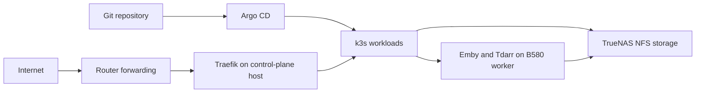

# Homelab Platform

**This is a sanitized reference implementation, not the live deployment repository.**
Domains, IP addresses, pool names and node selectors are examples. Read
[the private overlay guide](docs/private-overlays.md) before deploying anything.
The examples retain the original sync policies and schedules; customize them before registration.

A two-node k3s homelab managed through Argo CD, with persistent application
storage on TrueNAS. It runs household media, photo, file-sync and supporting
services, and is a learning project in Kubernetes, GitOps and operating stateful
applications.

Much of the code and documentation is AI-assisted. My goal is to understand,
review and maintain what I run, including the failures and trade-offs. Before
publication I plan to read the README, walk the project structure and personally
review every file. That review is still in progress; this is not a claim that
every generated line has already been reviewed or every recovery path tested.

## Current architecture

Documentation reconciled on **2026-11-05** against the checked-in manifests and
operator migration reports. Runtime results below are dated observations, not
continuous monitoring or a fresh live audit.

| Component | Role |
|---|---|
| MS-02 Ultra / `control-plane` | Physical Debian control plane and general application host; Traefik ingress |
| B580 / `gpu-worker` | Debian GPU worker for Emby and the Tdarr worker |
| TrueNAS | NFS application state, personal files and shared media; Scrutiny stays on the NAS |
| Argo CD | Reconciles registered Git paths; sync policy varies by Application |
| Traefik + cert-manager | Public routing and certificate management |



This is not a highly available cluster. There is one control plane, ingress is
pinned to its host, and persistent workloads depend on the NAS. Two nodes do not
provide automatic control-plane or public-ingress failover.

## Repository map

| Directory | Contents |
|---|---|
| [bootstrap/](bootstrap/README.md) | Host and application setup toolkit and initial Argo Application registrations |
| [argocd/edge-applications/](argocd/edge-applications/) | Child Application definitions managed by the historical `edge-applications` parent |
| [cluster/apps/](cluster/apps/) | Application workloads, Services, storage and app-specific public routes |
| [cluster/infrastructure/](cluster/infrastructure/) | Shared Traefik settings, certificate infrastructure, redirects, Argo settings and backup/notification CronJobs |
| [cluster/namespaces/](cluster/namespaces/namespaces-README.md) | Application namespace definitions |
| [docs/operations/](docs/operations/) | Operational and recovery guidance |
| [docs/incidents/](docs/incidents/) | Dated incident evidence |
| [docs/case-studies/](docs/case-studies/truenas-to-k3s.md) | Migration history and lessons |

Registration YAMLs intentionally remain in `bootstrap/`: they point Argo at
workload directories rather than duplicating those workloads. The parent name
`edge-applications` is historical; individual applications now own their own
public routes. Not every live Application has a checked-in registration yet.

## Applications

| App directory | Namespace | Purpose / migration evidence |
|---|---|---|
| [arr-stack](cluster/apps/arr-stack/README.md) | `media` | Prowlarr, Sonarr, Radarr and Unpackerr; operator verified request → download → library import |
| [qbittorrent](cluster/apps/qbittorrent/) | `media` | VPN-backed torrent client; migrated with config and resume files, tracker-approved 5.1.0 image retained |
| [nzbget](cluster/apps/nzbget/) | `media` | Usenet downloader; Radarr import confirmed 2026-11-04 |
| [emby](docs/operations/emby.md) | `media` | B580-hosted streaming; public playback and one hardware-transcode test confirmed |
| [tdarr](cluster/apps/tdarr/) | `media` | Server and B580 worker; migrated UI confirmed, complete post-migration job/copy-back verification outstanding |
| [immich](cluster/apps/immich/) | `data` | Photo library; access and uploads confirmed after control-plane migration |
| [nextcloud](cluster/apps/nextcloud/) | `data` | File sync; web files, Nautilus access and test-file sync confirmed 2026-11-04 |
| [seerr](cluster/apps/seerr/README.md) | `tools` | Requests; upgraded from Jellyseerr, request/import workflow confirmed |
| [tracearr](cluster/apps/tracearr/) | `tools` | Playback monitoring; operator confirmed operation after Emby migration |
| [tiastube](cluster/apps/tiastube/README.md) | `tools` | LAN-only usage/finance tracker; browser and Argo sync confirmed 2026-11-05 |
| [cloudflare-ddns](cluster/apps/cloudflare-ddns/README.md) | `tools` | Public IPv4 DNS updater; successful record check observed during migration |
| [openspeedtest](cluster/apps/openspeedtest/README.md) | `tools` | Public speed test; route verified after ownership consolidation |

Scrutiny remains outside k3s for drive access. Tailscale and the deferred Vikunja
instance are outside this repository's completed application-migration scope.
Kubernetes system components also use `kube-system`, `argocd` and `cert-manager`.

## Storage and recovery

Application NFS volumes use static PV/PVC definitions. The bundled k3s
local-path provisioner is separate; there is no dynamic NFS provisioner here.
A PV binds to one PVC; pods in the same namespace can share an RWX claim.
Different namespace claims require separate PV objects even when they reference
the same export. Declared PV capacities do not enforce NAS dataset quotas.

| NAS location | Use |
|---|---|
| `/mnt/application-pool/k3s-app-data/` | Most application configs and databases; separate directories per app |
| `/mnt/application-pool/configs/immich/storage` | Immich uploaded/derived assets; database has a separate `immich-db` directory |
| `/mnt/application-pool/configs/tdarr/temp` | Shared Tdarr processing cache |
| `/mnt/storage-pool/media-data` | Downloads and libraries, generally mounted as `/media-data` |
| `/mnt/storage-pool/nextcloud-data/user-data` | Nextcloud user files |

Central storage made it possible to replace compute hosts without copying all
media. It also makes NAS availability and NFS permission/locking behavior part
of application reliability. SQLite-on-NFS is an accepted lab trade-off, not a
recommendation for all deployments. Single replicas and Recreate reduce normal
writer overlap but do not provide fencing. NFS persistence is not a backup.

Read the [state and recovery prerequisites](docs/operations/application-state-recovery.md)
before restoring an app. Config, database, files, credentials and compatible
image versions must agree. Full disaster recovery has not been demonstrated.

## Automated protection

Five nightly backups cover Immich, Tracearr and Nextcloud databases, TiasTube
state/config and the k3s SQLite control plane. They retain 14 successful runs on
a separate NAS pool. A five-minute monitor sends backup failure/staleness and
recovery notifications to Discord. TrueNAS snapshot tasks cover application
state, personal files, media and the backup dataset.

Operator reports on 2026-11-05 confirm all five manual exports passed creation
checks, schedules were enabled and Discord delivery worked. Overnight scheduled
execution and restore drills are still pending. These copies share one NAS;
there is no off-machine disaster-recovery guarantee or general cluster outage
monitoring yet. See the [backup and notification runbook](cluster/infrastructure/backups/README.md)
for coverage, setup, raw diagnostic commands and limitations.

## Working with GitOps

1. Review the local manifest/code change and the app's operating constraints.
2. Commit and push deliberately: a push can deploy to auto-synced Applications.
3. Review Argo's diff and sync when the Application uses manual sync.
4. Verify rollout, logs and an actual application workflow.

Checked-in registrations and live policies may differ. Do not assume every app
has auto-sync, self-heal or pruning enabled. Existing Application ownership must
be preserved when reorganizing resources. App ingress and TLS definitions live
beside workloads; shared controller configuration remains in infrastructure.

Git describes desired resources, not all system state: NAS exports/ACLs, private
app configuration, credentials, router settings and some live registrations
remain outside it. See [deployment flow](docs/deployment-flow.md).

## Setup toolkit

```bash
bash bootstrap/bootstrap.sh host check
bash bootstrap/bootstrap.sh app list
bash bootstrap/bootstrap.sh app guide nextcloud
bash bootstrap/bootstrap.sh app guide database-backups
bash bootstrap/bootstrap.sh
```

The menu starts with read-only checks. Installation and mutation commands are
explicit and require confirmation. See the [toolkit guide](bootstrap/README.md)
for existing-node use, Secret handling and fresh-host prerequisites. Local safety
tests passed; live installation and mutation workflows remain unverified. This
is not a tested one-command rebuild or restore system.

## Review status

This source-only candidate starts without the deployment repository's Git history.
Local rendering and automated checks passed; the owner's file-by-file review is
still pending. Runtime evidence below describes the original deployment, not a
fresh installation of these example settings. See the
[publication checklist](docs/operations/publication.md).

## Decisions, evidence and remaining work

- [Architecture decisions](docs/architecture-decisions.md): original choices and historical context.
- [TrueNAS → k3s case study](docs/case-studies/truenas-to-k3s.md): migration, failures and verification.
- [Emby operations](docs/operations/emby.md): playback and transcode checks.
- [Earlier Tdarr integration](cluster/apps/tdarr/node-join.md): historical shared-cache/copy-back failure.

Remaining work:

- Verify a complete migrated Tdarr transcode and library copy-back during an idle window.
- Reconcile live Argo registrations/policies and node version skew in separate maintenance work.
- Test isolated backup restoration, verify overnight runs and add independent availability monitoring.
- Complete the owner's file-by-file review and documentation walkthrough.
- Review secrets, Git history, permissions and environment-specific details before publication.

Terraform and external Secret management are possible future work, not current
capabilities. Privileged GPU access and broad storage permissions remain lab
trade-offs to review. Publication readiness has not yet been established.
